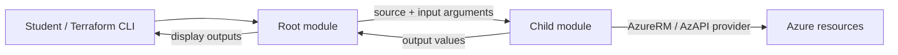
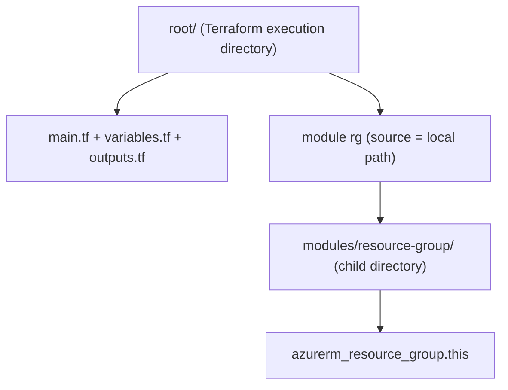
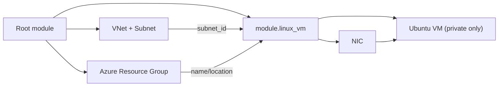

# Terraform Modules on Microsoft Azure — Step-by-Step Training, Examples and Labs

**Course level:** Beginner → Intermediate  
**Course type:** Tutorial + runnable hands-on exercises + instructor checkpoints  
**Updated:** 14 October 2026  
**Terraform:** `>= 1.15.0, < 2.0.0` (lab baseline: 1.15.9)  
**AzureRM provider:** `~> 5.9.0` (root; child modules declare `>= 5.9.0`)  
**Azure baseline:** `eastus`, Ubuntu Server 26.04 LTS, SSH-key login, private-only VM  
**Main goal:** Learn Terraform **modules**, not complex Azure networking or security features.

## How to use this training

This is the **master Markdown teaching document**. It includes the explanation, step-by-step instructions, mini-assignments, Mermaid diagrams, and **complete code for every exercise** below. Identical files also exist as runnable `.tf`, `.tfvars.example`, and `.tftest.hcl` files in the accompanying ZIP.

The course adapts the user's prior *Azure Terraform Hands-On — Part 2: Input Variables (All Six Types)* reference: AzureRM `5.9.x`, Terraform `1.15.x`, Azure `eastus`, the Ubuntu 26.04 LTS image, and familiar variable terminology. It intentionally **does not carry over the old Windows VM, passwords, public IP addresses or 13-resource state**. Those were useful for teaching variable types; here they would distract from modules. The new VM labs use SSH keys and no public IP addresses.

> **State safety — read before running:** Each numbered lab is a **standalone root/state snapshot** for teaching. These are progressive *code examples*, not a set of in-place upgrades to the old Azure Lab 4 deployment. Do not apply any lab folder to the state from the prior 13-resource course. Optionally apply one isolated lab, verify, `terraform destroy`, and move to the next. Only the explicitly labeled Bonus Lab 12 demonstrates an in-place state-preserving move.

> **Costs and networking:** Creating Azure VMs may incur hourly compute/disk charges. The VM exercises use a private-only NIC and no public IP. Azure VMs can be verified in the portal or via `az vm show` but cannot be SSH-accessed directly from the public internet. No private key or password is included in the ZIP.

## Learning outcomes

After completing the course, learners can explain root vs child modules; create and call a local module; pass required/optional, validated and sensitive inputs; expose and chain outputs; reuse a VM module across instances/environments; compose modules; select local, Git, and Registry sources; pin/upgrade module versions; and test/maintain modules without unnecessarily deploying cloud resources.

## Curriculum and code progression

| Course module | Covered concepts | Progressive labs | Azure resources per applied lab |
|---|---|---|---|
| **1. Introduction** | Modules, root vs child, purpose and trade-offs | 01 | 1 resource group |
| **2. Your first module** | Module folder, `source`, first module call, Terraform workflow | 02 | 1 resource group |
| **3. Inputs and outputs** | Required/optional values, defaults, outputs, validation, sensitive data | 03–04 | 1 resource group each |
| **4. Reusability** | Linux VM module, two calls, dev/prod, nesting/composition | 05–08 | 5 / 7 / 5 per env / 5 resources |
| **5. Sources and versioning** | Git tag, Registry sources, version pins, Azure Verified Modules | 09–10 | Git naming: random provider; AVM: RG + VNet/subnet + ancillary providers |
| **6. Best practices** | Providers, tests, docs, design and state-safe migration | 11 + Bonus 12 | 11: none (mock tests); 12: 1 RG |

The repository intentionally repeats a few short blocks between **standalone** labs so students can open any lab by itself. The actual Linux VM child module stays essentially identical across the VM exercises, which is the central lesson.

## Architecture at a glance



## Prerequisites — do once

1. Install Terraform 1.15.x (or a compatible supported version satisfying `required_version`), Azure CLI and Git. Have an Azure subscription where you can create resource groups, networks and VMs. Check any organization policies and quotas first.
2. Authenticate and select the intended lab subscription:

```bash
terraform version
az version
az login
az account set --subscription "YOUR_SUBSCRIPTION_ID"
export ARM_SUBSCRIPTION_ID="$(az account show --query id -o tsv)"
```

3. For VM labs 05–08 and each environment of Lab 07, create an SSH key **only if you do not already have one**:

```bash
ls -l ~/.ssh/id_ed25519.pub
# If the public key does not exist:
ssh-keygen -t ed25519 -f ~/.ssh/id_ed25519
```

Use a passphrase and protect `~/.ssh/id_ed25519`. Terraform reads only the `.pub` file. Students with existing keys should **not overwrite them**.

4. Check the chosen Ubuntu image and VM size in your target subscription/region. The course retains the exact image reference from the previous Azure exercise for continuity:

```bash
az vm image show --location eastus --urn Canonical:ubuntu-26_04-lts:server:latest
az vm list-skus --location eastus --resource-type virtualMachines --size Standard_B2s_v2 -o table
```

Availability varies by subscription, region, policy and quota. If a check fails, choose a permitted equivalent and edit the **shared VM module** deliberately rather than inventing resources. Terraform configuration can validate without guaranteeing deployment will succeed in a particular Azure subscription.

## The repeatable student workflow

Run these **inside the correct root folder**, never inside `modules/linux-vm` or another child directory:

```bash
terraform init
terraform fmt -recursive
terraform validate
terraform plan -out=tfplan
# Carefully check any destructive/replacement actions before you run:
terraform apply tfplan
terraform output
terraform state list
terraform destroy  # Only for this isolated training state, when finished
```

For labs with `terraform.tfvars.example`, first copy it to `terraform.tfvars` in the **root**. `terraform.tfvars` auto-loads; `.example` does not. For Lab 04, also set its disposable environment variable. Lab 11 prefers `terraform test` rather than apply. Lab 12 documents a different, intentional state-migration procedure. `terraform init -upgrade` is introduced later, not a default part of each run. Never blindly apply a plan with unexpected `-/+` replacements or resource deletion.

**Why no PIP/NSG in VM labs?** Those features are already covered in the earlier Azure lessons. The point here is the module boundary. Replacing VM images or adding public SSH exposure would distract from it.

---
## Module 1 — Introduction to Terraform Modules

A **Terraform module** is a directory containing Terraform configuration files. The directory where you invoke Terraform is the **root module**; a module loaded from `module { source = "..." }` is a **child module**. `main.tf`, `variables.tf`, and `outputs.tf` are common conventions, **not mandatory filenames**; Terraform loads the `.tf` files in one module directory together.

Think of a module as a small reusable building block: it accepts **inputs**, manages resources/other modules, and exposes **outputs**. Benefits include avoiding copy-paste, setting consistent standards and making changes easier. Costs include more layers, more interfaces to maintain, version coordination and hidden complexity. A module is worthwhile when a useful boundary or reuse need exists—not simply because every resource *can* be wrapped in one.



### Lab 01 — Root module: no `module` block yet

**Goal.** Recognize that any working Terraform directory is a module, even when it only has one `resource` block. Begin with the simplest possible Azure object: a resource group.

1. Enter `labs/01-root-module` and open `main.tf`.
2. Identify the resource *type* `azurerm_resource_group`, local label `lab`, and arguments `name`/`location`.
3. Run `terraform init`, `terraform validate`, `terraform plan`. Optionally apply, then run `terraform state list`.
4. Find the state address `azurerm_resource_group.lab`. Destroy before creating the next isolated exercise.

**Checkpoint:** Explain why a directory with only `main.tf` and `versions.tf` is called the *root module*.

**Mini-assignment:** Rename the Terraform local label `lab` to `training` **before applying** and predict the changed state address; do not change an already-applied lab without assessing state effects.

#### Complete code for this lab

All paths below are relative to `labs/01-root-module/`. The ZIP contains the identical ready-to-edit files.

**`main.tf`**

```hcl
resource "azurerm_resource_group" "lab" {
  name     = "rg-tfmod-01"
  location = "eastus"
}
```

**`versions.tf`**

```hcl
terraform {
  required_version = ">= 1.15.0, < 2.0.0"

  required_providers {
    azurerm = {
      source  = "hashicorp/azurerm"
      version = "~> 5.9.0"
    }
  }
}

provider "azurerm" {
  features {}
}
```

#### Run this lab

```bash
cd labs/01-root-module
terraform init
terraform fmt -recursive
terraform validate
terraform plan
# Optional after reviewing the plan: terraform apply
# When done: terraform destroy
```

---

## Module 2 — Creating Your First Module

A child module looks like any other Terraform directory: `.tf` files, normally with resource declarations, variable declarations and outputs. The root's `module` block selects a source. Terraform obtains local/remote modules during `terraform init`, then combines the graph when planning. Module names are Terraform addresses, not Azure names.

**Module call pattern:**

```hcl
module "example" {
  source = "./modules/resource-group"
}
```

Our first module deliberately has no variable or output yet. Those are the **next** lesson—not prerequisites for making a module.

### Lab 02 — Create your first local child module

**What changed from Lab 01:** The root no longer declares the resource. It delegates to `module "rg"`. The child directory owns the actual `azurerm_resource_group` block. This is a **new lab with its own state**; it is not an in-place migration from Lab 01.

1. Open `main.tf` in the root; read the tiny `module` call and its `source` path.
2. Open `modules/resource-group/main.tf`. This directory is the child module.
3. Run the standard workflow. If applied, `terraform state list` should show `module.rg.azurerm_resource_group.this`.
4. Notice that the child declares `required_providers`, but `provider "azurerm"` is only configured in the root.

**Checkpoint:** Distinguish between `module.rg` (module instance) and `azurerm_resource_group.this` (resource inside the module).

**Mini-assignment:** Count the number of Azure resources: **one**, not two.

#### Complete code for this lab

All paths below are relative to `labs/02-first-child/`. The ZIP contains the identical ready-to-edit files.

**`main.tf`**

```hcl
module "rg" {
  source = "./modules/resource-group"
}
```

**`versions.tf`**

```hcl
terraform {
  required_version = ">= 1.15.0, < 2.0.0"

  required_providers {
    azurerm = {
      source  = "hashicorp/azurerm"
      version = "~> 5.9.0"
    }
  }
}

provider "azurerm" {
  features {}
}
```

**`modules/resource-group/main.tf`**

```hcl
resource "azurerm_resource_group" "this" {
  name     = "rg-tfmod-02"
  location = "eastus"
}
```

**`modules/resource-group/versions.tf`**

```hcl
terraform {
  required_providers {
    azurerm = {
      source  = "hashicorp/azurerm"
      version = ">= 5.9.0"
    }
  }
}
```

#### Run this lab

```bash
cd labs/02-first-child
terraform init
terraform fmt -recursive
terraform validate
terraform plan
# Optional after reviewing the plan: terraform apply
# When done: terraform destroy
```

---

## Module 3 — Inputs, Outputs and Configuration

Modules become reusable when callers choose settings without changing child resource code. An input without `default` is **required**; an input with `default` is **optional**. Inputs belong in the child `variable` blocks; the root chooses values in its `module` arguments. Child `output` values are read through `module.<label>.<output_name>`.

| HCL feature | Short meaning | This course |
|---|---|---|
| `type = string` | single text input | Resource group name, region |
| `type = map(string)` | named text values | Optional resource tags |
| `default = ...` | optional input | region and tags |
| `validation {}` | reject invalid values | `rg-` name prefix |
| `sensitive = true` | hide normal CLI display | disposable example secret |
| `output { value = ... }` | exported module result | RG name/ID |

**Important:** Sensitive Terraform values may still enter state/plan files. Use secure state storage and a real secret-management process for production. SSH public keys are *not* passwords and do not need to be marked sensitive.

### Lab 03 — Pass variables in; expose outputs out

**What changed:** Lab 02 had hard-coded values inside the child. Lab 03 accepts the resource-group name and region as module inputs and returns the name and ID as outputs.

1. Copy `terraform.tfvars.example` to `terraform.tfvars`. Terraform auto-loads `terraform.tfvars` **in the root**.
2. Study root `var.rg_name` and module arguments `name = var.rg_name`, `location = var.azure_region`.
3. Study child `variables.tf`: `name`/`location` are required; `tags` is optional and has a default.
4. Study child `outputs.tf`; root output `module.rg.id` passes a value outside the module boundary.
5. Run the workflow. **After** applying, run `terraform output rg_name` and `terraform output rg_id`.

**Checkpoint:** Root variables and child variables are different declarations; values cross the boundary through the `module` block.

**Mini-assignment:** Change `rg_name` *before applying* to `rg-tfmod-03-demo` and predict the output. Keep `azure_region` absent to use its default.

#### Complete code for this lab

All paths below are relative to `labs/03-inputs-outputs/`. The ZIP contains the identical ready-to-edit files.

**`main.tf`**

```hcl
module "rg" {
  source   = "./modules/resource-group"
  name     = var.rg_name
  location = var.azure_region
}
```

**`outputs.tf`**

```hcl
output "rg_name" {
  value = module.rg.name
}

output "rg_id" {
  value = module.rg.id
}
```

**`terraform.tfvars.example`**

```hcl
rg_name = "rg-tfmod-03"
# azure_region is optional; defaults to eastus.
```

**`variables.tf`**

```hcl
variable "rg_name" {
  type = string
}

variable "azure_region" {
  type    = string
  default = "eastus"
}
```

**`versions.tf`**

```hcl
terraform {
  required_version = ">= 1.15.0, < 2.0.0"

  required_providers {
    azurerm = {
      source  = "hashicorp/azurerm"
      version = "~> 5.9.0"
    }
  }
}

provider "azurerm" {
  features {}
}
```

**`modules/resource-group/main.tf`**

```hcl
resource "azurerm_resource_group" "this" {
  name     = var.name
  location = var.location
  tags     = var.tags
}
```

**`modules/resource-group/outputs.tf`**

```hcl
output "name" {
  description = "Name created by the module."
  value       = azurerm_resource_group.this.name
}

output "id" {
  description = "Azure resource group ID."
  value       = azurerm_resource_group.this.id
}
```

**`modules/resource-group/variables.tf`**

```hcl
variable "name" {
  description = "Resource group name."
  type        = string
}

variable "location" {
  description = "Azure region."
  type        = string
}

variable "tags" {
  description = "Optional resource tags."
  type        = map(string)
  default     = { course = "terraform-modules" }
}
```

**`modules/resource-group/versions.tf`**

```hcl
terraform {
  required_providers {
    azurerm = {
      source  = "hashicorp/azurerm"
      version = ">= 5.9.0"
    }
  }
}
```

#### Run this lab

```bash
cd labs/03-inputs-outputs
cp terraform.tfvars.example terraform.tfvars
terraform init
terraform fmt -recursive
terraform validate
terraform plan
# Optional after reviewing the plan: terraform apply
# When done: terraform destroy
```

---

### Lab 04 — Add validation and understand sensitive outputs

**What changed:** We validate `rg_name` and send a **disposable demonstration secret** through a tiny child module. The Azure resource group never receives that secret.

1. Copy `terraform.tfvars.example` to `terraform.tfvars`.
2. Set `export TF_VAR_training_secret="throwaway-training-value"` in your shell. Do not use a real password.
3. Observe `validation` on `rg_name` and `sensitive = true` in root, child input and child output.
4. Run `terraform init`, `terraform validate`, `terraform plan` and, if desired, `terraform apply`.
5. After apply, `terraform output` shows `(sensitive value)` while `terraform output -raw redacted_demo` **explicitly prints the disposable demo value**.
6. Try a failed plan with `terraform plan -var='rg_name=wrong-name'`; restore the original value afterwards.

**Checkpoint:** Marking a value `sensitive` hides default CLI rendering; it does **not** encrypt or guarantee omission from local/remote state or saved plan files.

**Mini-assignment:** Explain why passing real secrets in `.tfvars` committed to Git is unsafe.

#### Complete code for this lab

All paths below are relative to `labs/04-validation-sensitive/`. The ZIP contains the identical ready-to-edit files.

**`main.tf`**

```hcl
module "rg" {
  source   = "./modules/resource-group"
  name     = var.rg_name
  location = var.azure_region
}

module "secret_example" {
  source = "./modules/secret-example"
  value  = var.training_secret
}
```

**`outputs.tf`**

```hcl
output "rg_name" {
  value = module.rg.name
}

output "redacted_demo" {
  description = "Sensitive is redacted in normal output, NOT encrypted in state."
  value       = module.secret_example.value
  sensitive   = true
}
```

**`terraform.tfvars.example`**

```hcl
rg_name = "rg-tfmod-04"
```

**`variables.tf`**

```hcl
variable "rg_name" {
  type = string

  validation {
    condition     = startswith(var.rg_name, "rg-")
    error_message = "The resource group name must start with rg-."
  }
}

variable "azure_region" {
  type    = string
  default = "eastus"
}

variable "training_secret" {
  description = "Disposable demo-only text; never use a real password."
  type        = string
  sensitive   = true
}
```

**`versions.tf`**

```hcl
terraform {
  required_version = ">= 1.15.0, < 2.0.0"

  required_providers {
    azurerm = {
      source  = "hashicorp/azurerm"
      version = "~> 5.9.0"
    }
  }
}

provider "azurerm" {
  features {}
}
```

**`modules/resource-group/main.tf`**

```hcl
resource "azurerm_resource_group" "this" {
  name     = var.name
  location = var.location
  tags     = var.tags
}
```

**`modules/resource-group/outputs.tf`**

```hcl
output "name" {
  description = "Name created by the module."
  value       = azurerm_resource_group.this.name
}

output "id" {
  description = "Azure resource group ID."
  value       = azurerm_resource_group.this.id
}
```

**`modules/resource-group/variables.tf`**

```hcl
variable "name" {
  description = "Resource group name."
  type        = string
  validation {
    condition     = startswith(var.name, "rg-")
    error_message = "Resource group names in this course must start with rg-."
  }
}

variable "location" {
  description = "Azure region."
  type        = string
}

variable "tags" {
  description = "Optional resource tags."
  type        = map(string)
  default     = { course = "terraform-modules" }
}
```

**`modules/resource-group/versions.tf`**

```hcl
terraform {
  required_providers {
    azurerm = {
      source  = "hashicorp/azurerm"
      version = ">= 5.9.0"
    }
  }
}
```

**`modules/secret-example/outputs.tf`**

```hcl
output "value" {
  value     = var.value
  sensitive = true
}
```

**`modules/secret-example/variables.tf`**

```hcl
variable "value" {
  type      = string
  sensitive = true
}
```

#### Run and validate the sensitive-value demo

```bash
cd labs/04-validation-sensitive
cp terraform.tfvars.example terraform.tfvars
export TF_VAR_training_secret="throwaway-training-value"
terraform init && terraform validate && terraform plan
# After optional terraform apply:
terraform output redacted_demo
terraform output -raw redacted_demo # Explicitly prints ONLY disposable demo data.
```

---

## Module 4 — Reusable Modules in Practice

This module uses a tiny, realistic Ubuntu Linux VM child module: **one network interface plus one VM**. All required Azure networking is provisioned in the calling root or in a separate small `network` module. In the first exercise, `resource_group + VNet + subnet = 3` root resources, and `NIC + VM = 2` child resources. We reuse the exact same child design, first twice, then across two roots, and finally as a submodule of a stack.



Resource outputs passed as arguments create implicit Terraform dependencies. There is no need to introduce explicit `depends_on` for the simple examples.

### Lab 05 — Build your own reusable Ubuntu VM module

**What changed:** We graduate from a one-resource module to a practical, **two-resource** Linux VM module. The root owns the prerequisite resource group, VNet and subnet; the child owns only the NIC and VM.

1. Create an Ed25519 SSH key if `~/.ssh/id_ed25519.pub` does not exist (setup section). The module consumes its **public** key, not your private key.
2. Open `main.tf`: find three root resource blocks, then one module call with the subnet ID and public key.
3. Open `modules/linux-vm/main.tf`: count the two resources (NIC and Linux VM). The Ubuntu image matches the uploaded previous lab's 26.04 LTS image reference.
4. Run `terraform init`, `terraform validate`, `terraform plan`; inspect the five total resources. Apply only if subscription quota/image availability are confirmed.
5. After apply, run `terraform output private_ip`, then `az vm show -g rg-tfmod-05 -n vm-tfmod-05 --query provisioningState -o tsv`.

**Checkpoint:** This VM has **no public IP**. A private IP is not directly SSH-reachable from the public internet. Connecting requires an approved private path (VPN/Bastion/private network), deliberately outside module basics.

**Mini-assignment:** Change the module argument `vm_size` via the root variable and read the plan **before** applying.

#### Complete code for this lab

All paths below are relative to `labs/05-linux-vm/`. The ZIP contains the identical ready-to-edit files.

**`main.tf`**

```hcl
resource "azurerm_resource_group" "lab" {
  name     = "rg-tfmod-05"
  location = var.azure_region
}

resource "azurerm_virtual_network" "lab" {
  name                = "vnet-tfmod-05"
  location            = azurerm_resource_group.lab.location
  resource_group_name = azurerm_resource_group.lab.name
  address_space       = ["10.50.0.0/16"]
}

resource "azurerm_subnet" "vm" {
  name                 = "snet-vm"
  resource_group_name  = azurerm_resource_group.lab.name
  virtual_network_name = azurerm_virtual_network.lab.name
  address_prefixes     = ["10.50.1.0/24"]
}

module "linux_vm" {
  source              = "./modules/linux-vm"
  name                = "vm-tfmod-05"
  location            = azurerm_resource_group.lab.location
  resource_group_name = azurerm_resource_group.lab.name
  subnet_id           = azurerm_subnet.vm.id
  ssh_public_key      = file(pathexpand("~/.ssh/id_ed25519.pub"))
  vm_size             = var.vm_size
}
```

**`outputs.tf`**

```hcl
output "vm_id" {
  value = module.linux_vm.vm_id
}

output "private_ip" {
  value = module.linux_vm.private_ip
}
```

**`variables.tf`**

```hcl
variable "azure_region" {
  type    = string
  default = "eastus"
}

variable "vm_size" {
  type    = string
  default = "Standard_B2s_v2"
}
```

**`versions.tf`**

```hcl
terraform {
  required_version = ">= 1.15.0, < 2.0.0"

  required_providers {
    azurerm = {
      source  = "hashicorp/azurerm"
      version = "~> 5.9.0"
    }
  }
}

provider "azurerm" {
  features {}
}
```

**`modules/linux-vm/main.tf`**

```hcl
resource "azurerm_network_interface" "this" {
  name                = "nic-${var.name}"
  location            = var.location
  resource_group_name = var.resource_group_name

  ip_configuration {
    name                          = "internal"
    subnet_id                     = var.subnet_id
    private_ip_address_allocation = "Dynamic"
  }
}

resource "azurerm_linux_virtual_machine" "this" {
  name                = var.name
  location            = var.location
  resource_group_name = var.resource_group_name
  size                  = var.vm_size
  admin_username        = var.admin_username
  network_interface_ids = [azurerm_network_interface.this.id]

  admin_ssh_key {
    username   = var.admin_username
    public_key = var.ssh_public_key
  }

  os_disk {
    caching              = "ReadWrite"
    storage_account_type = "Standard_LRS"
  }

  source_image_reference {
    publisher = "Canonical"
    offer     = "ubuntu-26_04-lts"
    sku       = "server"
    version   = "latest"
  }
}
```

**`modules/linux-vm/outputs.tf`**

```hcl
output "vm_id" {
  value = azurerm_linux_virtual_machine.this.id
}

output "vm_name" {
  value = azurerm_linux_virtual_machine.this.name
}

output "private_ip" {
  value = azurerm_network_interface.this.private_ip_address
}
```

**`modules/linux-vm/variables.tf`**

```hcl
variable "name"                { type = string }
variable "location"            { type = string }
variable "resource_group_name" { type = string }
variable "subnet_id"           { type = string }
variable "ssh_public_key"      { type = string }

variable "vm_size" {
  type    = string
  default = "Standard_B2s_v2"
}

variable "admin_username" {
  type    = string
  default = "labadmin"
}
```

**`modules/linux-vm/versions.tf`**

```hcl
terraform {
  required_providers {
    azurerm = {
      source  = "hashicorp/azurerm"
      version = ">= 5.9.0"
    }
  }
}
```

#### Run this lab

```bash
cd labs/05-linux-vm
terraform init
terraform fmt -recursive
terraform validate
terraform plan
# Optional after reviewing the plan: terraform apply
# When done: terraform destroy
```

---

### Lab 06 — Reuse the same module with two different instances

**What changed:** Instead of writing a second VM resource and NIC resource manually, the root calls `./modules/linux-vm` twice as `module.app` and `module.worker`.

1. Compare Lab 05 and Lab 06. The child module stays the same; only two independent module calls and root outputs change.
2. Run the workflow, and check that the plan creates three shared network resources plus two resources inside **each** VM module: **seven Azure resources** total.
3. After apply, run `terraform output vm_names` and `terraform output private_ips`.
4. Check state addresses under `module.app.*` and `module.worker.*`.

**Checkpoint:** Two *module instances* can reuse identical source code while owning separate state addresses and distinct Azure objects.

**Mini-assignment:** Predict the effect of accidentally using the same Azure VM name for both module instances within the same resource group. This is an Azure naming conflict, not a Terraform-module limitation.

**Cost note:** This lab creates two VMs. Skip apply if you only want to study the module concept; destroy when finished.

#### Complete code for this lab

All paths below are relative to `labs/06-two-vms/`. The ZIP contains the identical ready-to-edit files.

**`main.tf`**

```hcl
resource "azurerm_resource_group" "lab" {
  name     = "rg-tfmod-06"
  location = var.azure_region
}

resource "azurerm_virtual_network" "lab" {
  name                = "vnet-tfmod-06"
  location            = azurerm_resource_group.lab.location
  resource_group_name = azurerm_resource_group.lab.name
  address_space       = ["10.60.0.0/16"]
}

resource "azurerm_subnet" "vm" {
  name                 = "snet-vm"
  resource_group_name  = azurerm_resource_group.lab.name
  virtual_network_name = azurerm_virtual_network.lab.name
  address_prefixes     = ["10.60.1.0/24"]
}

module "app" {
  source              = "./modules/linux-vm"
  name                = "vm-tfmod-06-app"
  location            = azurerm_resource_group.lab.location
  resource_group_name = azurerm_resource_group.lab.name
  subnet_id           = azurerm_subnet.vm.id
  ssh_public_key      = file(pathexpand("~/.ssh/id_ed25519.pub"))
  vm_size             = var.vm_size
}

module "worker" {
  source              = "./modules/linux-vm"
  name                = "vm-tfmod-06-worker"
  location            = azurerm_resource_group.lab.location
  resource_group_name = azurerm_resource_group.lab.name
  subnet_id           = azurerm_subnet.vm.id
  ssh_public_key      = file(pathexpand("~/.ssh/id_ed25519.pub"))
  vm_size             = var.vm_size
}
```

**`outputs.tf`**

```hcl
output "vm_names" {
  value = [module.app.vm_name, module.worker.vm_name]
}

output "private_ips" {
  value = [module.app.private_ip, module.worker.private_ip]
}
```

**`variables.tf`**

```hcl
variable "azure_region" {
  type    = string
  default = "eastus"
}

variable "vm_size" {
  type    = string
  default = "Standard_B2s_v2"
}
```

**`versions.tf`**

```hcl
terraform {
  required_version = ">= 1.15.0, < 2.0.0"

  required_providers {
    azurerm = {
      source  = "hashicorp/azurerm"
      version = "~> 5.9.0"
    }
  }
}

provider "azurerm" {
  features {}
}
```

**`modules/linux-vm/main.tf`**

```hcl
resource "azurerm_network_interface" "this" {
  name                = "nic-${var.name}"
  location            = var.location
  resource_group_name = var.resource_group_name

  ip_configuration {
    name                          = "internal"
    subnet_id                     = var.subnet_id
    private_ip_address_allocation = "Dynamic"
  }
}

resource "azurerm_linux_virtual_machine" "this" {
  name                = var.name
  location            = var.location
  resource_group_name = var.resource_group_name
  size                  = var.vm_size
  admin_username        = var.admin_username
  network_interface_ids = [azurerm_network_interface.this.id]

  admin_ssh_key {
    username   = var.admin_username
    public_key = var.ssh_public_key
  }

  os_disk {
    caching              = "ReadWrite"
    storage_account_type = "Standard_LRS"
  }

  source_image_reference {
    publisher = "Canonical"
    offer     = "ubuntu-26_04-lts"
    sku       = "server"
    version   = "latest"
  }
}
```

**`modules/linux-vm/outputs.tf`**

```hcl
output "vm_id" {
  value = azurerm_linux_virtual_machine.this.id
}

output "vm_name" {
  value = azurerm_linux_virtual_machine.this.name
}

output "private_ip" {
  value = azurerm_network_interface.this.private_ip_address
}
```

**`modules/linux-vm/variables.tf`**

```hcl
variable "name"                { type = string }
variable "location"            { type = string }
variable "resource_group_name" { type = string }
variable "subnet_id"           { type = string }
variable "ssh_public_key"      { type = string }

variable "vm_size" {
  type    = string
  default = "Standard_B2s_v2"
}

variable "admin_username" {
  type    = string
  default = "labadmin"
}
```

**`modules/linux-vm/versions.tf`**

```hcl
terraform {
  required_providers {
    azurerm = {
      source  = "hashicorp/azurerm"
      version = ">= 5.9.0"
    }
  }
}
```

#### Run this lab

```bash
cd labs/06-two-vms
terraform init
terraform fmt -recursive
terraform validate
terraform plan
# Optional after reviewing the plan: terraform apply
# When done: terraform destroy
```

---

### Lab 07 — Use one child module from dev and prod roots

**What changed:** One shared module under `labs/07-environments/modules/linux-vm` serves **two root configurations**, `environments/dev` and `environments/prod`. Each root has its own `terraform.tfvars`, Terraform state and naming/CIDR values.

1. Start in `labs/07-environments/environments/dev` and copy `terraform.tfvars.example` to `terraform.tfvars`.
2. Run the standard workflow **from dev/**; observe `rg-tfmod-dev` and `vm-tfmod-dev`.
3. Independently change into `../prod`; copy its `.example` file and run its own `init` and `plan`.
4. Compare the distinct environment names, address spaces, module `source = "../../modules/linux-vm"`, and separate state paths.
5. If you applied either root, destroy **that root** individually. Do not run Terraform from `labs/07-environments/` itself.

**Checkpoint:** Changing one `.tfvars` value in a *single shared root/state* does not give you isolated dev/prod environments. It typically changes/replaces what that state already manages.

**Mini-assignment:** Set a different `vm_size` in the prod root's `.tfvars` and confirm only its plan reflects the difference.

**Production note:** The `prod` folder is a **teaching simulation**, not a production-grade security/HA deployment.

#### Complete code for this lab

All paths below are relative to `labs/07-environments/`. The ZIP contains the identical ready-to-edit files.

**`environments/dev/main.tf`**

```hcl
resource "azurerm_resource_group" "lab" {
  name     = "rg-tfmod-${var.environment}"
  location = var.azure_region
}

resource "azurerm_virtual_network" "lab" {
  name                = "vnet-tfmod-${var.environment}"
  location            = azurerm_resource_group.lab.location
  resource_group_name = azurerm_resource_group.lab.name
  address_space       = [var.vnet_cidr]
}

resource "azurerm_subnet" "vm" {
  name                 = "snet-vm"
  resource_group_name  = azurerm_resource_group.lab.name
  virtual_network_name = azurerm_virtual_network.lab.name
  address_prefixes     = [var.subnet_cidr]
}

module "linux_vm" {
  source              = "../../modules/linux-vm"
  name                = "vm-tfmod-${var.environment}"
  location            = azurerm_resource_group.lab.location
  resource_group_name = azurerm_resource_group.lab.name
  subnet_id           = azurerm_subnet.vm.id
  ssh_public_key      = file(pathexpand("~/.ssh/id_ed25519.pub"))
  vm_size             = var.vm_size
}
```

**`environments/dev/outputs.tf`**

```hcl
output "vm_name" {
  value = module.linux_vm.vm_name
}
```

**`environments/dev/terraform.tfvars.example`**

```hcl
environment = "dev"
azure_region = "eastus"
vm_size      = "Standard_B2s_v2"
vnet_cidr    = "10.70.0.0/16"
subnet_cidr  = "10.70.1.0/24"
```

**`environments/dev/variables.tf`**

```hcl
variable "environment" { type = string }
variable "azure_region" { type = string }
variable "vm_size"     { type = string }
variable "vnet_cidr"   { type = string }
variable "subnet_cidr" { type = string }
```

**`environments/dev/versions.tf`**

```hcl
terraform {
  required_version = ">= 1.15.0, < 2.0.0"

  required_providers {
    azurerm = {
      source  = "hashicorp/azurerm"
      version = "~> 5.9.0"
    }
  }
}

provider "azurerm" {
  features {}
}
```

**`environments/prod/main.tf`**

```hcl
resource "azurerm_resource_group" "lab" {
  name     = "rg-tfmod-${var.environment}"
  location = var.azure_region
}

resource "azurerm_virtual_network" "lab" {
  name                = "vnet-tfmod-${var.environment}"
  location            = azurerm_resource_group.lab.location
  resource_group_name = azurerm_resource_group.lab.name
  address_space       = [var.vnet_cidr]
}

resource "azurerm_subnet" "vm" {
  name                 = "snet-vm"
  resource_group_name  = azurerm_resource_group.lab.name
  virtual_network_name = azurerm_virtual_network.lab.name
  address_prefixes     = [var.subnet_cidr]
}

module "linux_vm" {
  source              = "../../modules/linux-vm"
  name                = "vm-tfmod-${var.environment}"
  location            = azurerm_resource_group.lab.location
  resource_group_name = azurerm_resource_group.lab.name
  subnet_id           = azurerm_subnet.vm.id
  ssh_public_key      = file(pathexpand("~/.ssh/id_ed25519.pub"))
  vm_size             = var.vm_size
}
```

**`environments/prod/outputs.tf`**

```hcl
output "vm_name" {
  value = module.linux_vm.vm_name
}
```

**`environments/prod/terraform.tfvars.example`**

```hcl
environment = "prod"
azure_region = "eastus"
vm_size      = "Standard_B2s_v2"
vnet_cidr    = "10.80.0.0/16"
subnet_cidr  = "10.80.1.0/24"
```

**`environments/prod/variables.tf`**

```hcl
variable "environment" { type = string }
variable "azure_region" { type = string }
variable "vm_size"     { type = string }
variable "vnet_cidr"   { type = string }
variable "subnet_cidr" { type = string }
```

**`environments/prod/versions.tf`**

```hcl
terraform {
  required_version = ">= 1.15.0, < 2.0.0"

  required_providers {
    azurerm = {
      source  = "hashicorp/azurerm"
      version = "~> 5.9.0"
    }
  }
}

provider "azurerm" {
  features {}
}
```

**`modules/linux-vm/main.tf`**

```hcl
resource "azurerm_network_interface" "this" {
  name                = "nic-${var.name}"
  location            = var.location
  resource_group_name = var.resource_group_name

  ip_configuration {
    name                          = "internal"
    subnet_id                     = var.subnet_id
    private_ip_address_allocation = "Dynamic"
  }
}

resource "azurerm_linux_virtual_machine" "this" {
  name                = var.name
  location            = var.location
  resource_group_name = var.resource_group_name
  size                  = var.vm_size
  admin_username        = var.admin_username
  network_interface_ids = [azurerm_network_interface.this.id]

  admin_ssh_key {
    username   = var.admin_username
    public_key = var.ssh_public_key
  }

  os_disk {
    caching              = "ReadWrite"
    storage_account_type = "Standard_LRS"
  }

  source_image_reference {
    publisher = "Canonical"
    offer     = "ubuntu-26_04-lts"
    sku       = "server"
    version   = "latest"
  }
}
```

**`modules/linux-vm/outputs.tf`**

```hcl
output "vm_id" {
  value = azurerm_linux_virtual_machine.this.id
}

output "vm_name" {
  value = azurerm_linux_virtual_machine.this.name
}

output "private_ip" {
  value = azurerm_network_interface.this.private_ip_address
}
```

**`modules/linux-vm/variables.tf`**

```hcl
variable "name"                { type = string }
variable "location"            { type = string }
variable "resource_group_name" { type = string }
variable "subnet_id"           { type = string }
variable "ssh_public_key"      { type = string }

variable "vm_size" {
  type    = string
  default = "Standard_B2s_v2"
}

variable "admin_username" {
  type    = string
  default = "labadmin"
}
```

**`modules/linux-vm/versions.tf`**

```hcl
terraform {
  required_providers {
    azurerm = {
      source  = "hashicorp/azurerm"
      version = ">= 5.9.0"
    }
  }
}
```

#### Run each environment independently

```bash
cd labs/07-environments/environments/dev
cp terraform.tfvars.example terraform.tfvars
terraform init && terraform validate && terraform plan
# Optional: terraform apply, then terraform output vm_name; terraform destroy
cd ../prod
cp terraform.tfvars.example terraform.tfvars
terraform init && terraform validate && terraform plan
```

---

### Lab 08 — Compose a stack module from two child modules

**What changed:** The root calls only `module "stack"`. Inside `modules/stack`, the stack calls `module "network"` and `module "linux_vm"`. The network output `subnet_id` becomes an input to the VM child.

1. Read root `main.tf`: one top-level `module "stack"` call.
2. Read `modules/stack/main.tf`. Find `module.network.subnet_id` passed as `subnet_id` to `module.linux_vm`.
3. Trace the actual Azure resources in `modules/network` (RG, VNet, subnet) and `modules/linux-vm` (NIC, VM).
4. Run `terraform init`, `terraform validate`, `terraform plan` and inspect module nesting in the plan.
5. Optionally apply and run `terraform output vm_name`.

**Checkpoint:** The path `module.stack.module.linux_vm.azurerm_linux_virtual_machine.this` is one resource within a composed module tree.

**Mini-assignment:** Without changing the VM module, explain how a second stack could receive a different `project` argument.

#### Complete code for this lab

All paths below are relative to `labs/08-composition/`. The ZIP contains the identical ready-to-edit files.

**`main.tf`**

```hcl
module "stack" {
  source         = "./modules/stack"
  project        = "tfmod-08"
  location       = "eastus"
  ssh_public_key = file(pathexpand("~/.ssh/id_ed25519.pub"))
}
```

**`outputs.tf`**

```hcl
output "vm_name" {
  value = module.stack.vm_name
}

output "resource_group_name" {
  value = module.stack.resource_group_name
}
```

**`versions.tf`**

```hcl
terraform {
  required_version = ">= 1.15.0, < 2.0.0"

  required_providers {
    azurerm = {
      source  = "hashicorp/azurerm"
      version = "~> 5.9.0"
    }
  }
}

provider "azurerm" {
  features {}
}
```

**`modules/linux-vm/main.tf`**

```hcl
resource "azurerm_network_interface" "this" {
  name                = "nic-${var.name}"
  location            = var.location
  resource_group_name = var.resource_group_name

  ip_configuration {
    name                          = "internal"
    subnet_id                     = var.subnet_id
    private_ip_address_allocation = "Dynamic"
  }
}

resource "azurerm_linux_virtual_machine" "this" {
  name                = var.name
  location            = var.location
  resource_group_name = var.resource_group_name
  size                  = var.vm_size
  admin_username        = var.admin_username
  network_interface_ids = [azurerm_network_interface.this.id]

  admin_ssh_key {
    username   = var.admin_username
    public_key = var.ssh_public_key
  }

  os_disk {
    caching              = "ReadWrite"
    storage_account_type = "Standard_LRS"
  }

  source_image_reference {
    publisher = "Canonical"
    offer     = "ubuntu-26_04-lts"
    sku       = "server"
    version   = "latest"
  }
}
```

**`modules/linux-vm/outputs.tf`**

```hcl
output "vm_id" {
  value = azurerm_linux_virtual_machine.this.id
}

output "vm_name" {
  value = azurerm_linux_virtual_machine.this.name
}

output "private_ip" {
  value = azurerm_network_interface.this.private_ip_address
}
```

**`modules/linux-vm/variables.tf`**

```hcl
variable "name"                { type = string }
variable "location"            { type = string }
variable "resource_group_name" { type = string }
variable "subnet_id"           { type = string }
variable "ssh_public_key"      { type = string }

variable "vm_size" {
  type    = string
  default = "Standard_B2s_v2"
}

variable "admin_username" {
  type    = string
  default = "labadmin"
}
```

**`modules/linux-vm/versions.tf`**

```hcl
terraform {
  required_providers {
    azurerm = {
      source  = "hashicorp/azurerm"
      version = ">= 5.9.0"
    }
  }
}
```

**`modules/network/main.tf`**

```hcl
resource "azurerm_resource_group" "this" {
  name     = "rg-${var.project}"
  location = var.location
}

resource "azurerm_virtual_network" "this" {
  name                = "vnet-${var.project}"
  location            = var.location
  resource_group_name = azurerm_resource_group.this.name
  address_space       = ["10.88.0.0/16"]
}

resource "azurerm_subnet" "this" {
  name                 = "snet-vm"
  resource_group_name  = azurerm_resource_group.this.name
  virtual_network_name = azurerm_virtual_network.this.name
  address_prefixes     = ["10.88.1.0/24"]
}
```

**`modules/network/outputs.tf`**

```hcl
output "resource_group_name" {
  value = azurerm_resource_group.this.name
}

output "subnet_id" {
  value = azurerm_subnet.this.id
}
```

**`modules/network/variables.tf`**

```hcl
variable "project"  { type = string }
variable "location" { type = string }
```

**`modules/network/versions.tf`**

```hcl
terraform {
  required_providers {
    azurerm = {
      source  = "hashicorp/azurerm"
      version = ">= 5.9.0"
    }
  }
}
```

**`modules/stack/main.tf`**

```hcl
module "network" {
  source   = "../network"
  project  = var.project
  location = var.location
}

module "linux_vm" {
  source              = "../linux-vm"
  name                = "vm-${var.project}"
  location            = var.location
  resource_group_name = module.network.resource_group_name
  subnet_id           = module.network.subnet_id
  ssh_public_key      = var.ssh_public_key
}
```

**`modules/stack/outputs.tf`**

```hcl
output "vm_name" {
  value = module.linux_vm.vm_name
}

output "resource_group_name" {
  value = module.network.resource_group_name
}
```

**`modules/stack/variables.tf`**

```hcl
variable "project"        { type = string }
variable "location"       { type = string }
variable "ssh_public_key" { type = string }
```

#### Run this lab

```bash
cd labs/08-composition
terraform init
terraform fmt -recursive
terraform validate
terraform plan
# Optional after reviewing the plan: terraform apply
# When done: terraform destroy
```

---

## Module 5 — Module Sources and Versioning

Terraform can load a module from a **local directory**, a **Git URL** or the **Terraform Registry**. Local paths begin with `./` or `../`; Git sources use `git::...` and typically select a tag/commit via `?ref=`; Registry sources use `namespace/name/provider` and support a separate `version` argument.

| Source | Example | How to select a release |
|---|---|---|
| Local | `./modules/linux-vm` | Files are part of the same repository/working tree |
| Git | `git::https://...repo.git?ref=0.4.3` | `?ref=` tag / commit hash / branch |
| Registry | `Azure/avm-res-resources-resourcegroup/azurerm` | `version = "0.4.0"` |

Use *pinned* module releases for repeatable training/production. When changing a module's `source` or selected release, run `terraform init` again. `terraform init -upgrade` requests the newest module/provider dependencies **allowed by your constraints**; it cannot move an exact `version = "0.4.0"` to `0.5.0` until you edit that constraint.


**Version-constraint experiment (do not run in an active deployment without reviewing the plan):** Change one pinned Registry `version = "0.4.0"` to `version = "~> 0.4.0"`. This permits compatible `0.4.x` patches, not `0.5.0`. Then run `terraform init -upgrade`, inspect the dependency selections and `terraform plan`, and pin the selected release again for repeatable teaching. Provider `.terraform.lock.hcl` changes and Registry module versions are related but not the same mechanism.

Azure **Verified Modules (AVM)** are real published modules maintained against Azure guidance. Their short callers can still install multiple providers and create several implementation resources; review upstream requirements, security defaults, licenses, examples and release history before adoption.

### Lab 09 — Consume a Git module with a pinned tag

**What changed:** The module `source` is no longer a `./local-path`. It is a remote Git source, pinned with `?ref=0.4.3`. This exercise uses Azure's naming module solely to teach Git-source syntax; this specific repository was **archived on September 15, 2026**, so it is not a recommendation for new long-lived production dependencies.

1. Open `main.tf` and identify the `git::https://...git?ref=0.4.3` source.
2. Run `terraform init`; Terraform downloads the Git repository and its dependencies.
3. Run `terraform validate`, `terraform plan`. After an optional `apply`, inspect `terraform output example_resource_group_name`.
4. Change the tag **only after verifying a replacement release exists**; rerun `terraform init` to refresh the source.

**Checkpoint:** Git modules use `?ref=<tag|commit|branch>`; **do not** use a `version` argument with an ordinary Git module source.

**Mini-assignment:** Write, on paper, a Git source URL pinned to a commit SHA instead of a moving branch.

#### Complete code for this lab

All paths below are relative to `labs/09-git-source/`. The ZIP contains the identical ready-to-edit files.

**`main.tf`**

```hcl
terraform {
  required_version = ">= 1.15.0, < 2.0.0"
}

module "naming" {
  source = "git::https://github.com/Azure/terraform-azurerm-naming.git?ref=0.4.3"
  suffix = ["tfmod", "git"]
}

output "example_resource_group_name" {
  value = module.naming.resource_group.name
}
```

#### Run this lab

```bash
cd labs/09-git-source
terraform init
terraform fmt -recursive
terraform validate
terraform plan
# Optional after reviewing the plan: terraform apply
# When done: terraform destroy
```

---

### Lab 10 — Use real Azure Registry/AVM modules

**What changed:** We now consume the public Terraform Registry using exact `source` and `version` values. Three published modules demonstrate naming, resource-group provisioning, and VNet/subnet provisioning without writing the long Azure resources yourself.

1. Read `module "naming"` (`Azure/naming/azurerm` 0.4.3), `module "rg"` (Azure Verified Resource Group 0.4.0), `module "vnet"` (Azure Verified Virtual Network 0.22.2).
2. Notice how `module.naming.resource_group.name` flows into RG `name`, then `module.rg.resource_id` flows into the VNet `parent_id`.
3. Run `terraform init` to download the external modules and required providers, including Azure AzAPI.
4. Run `terraform validate`, `terraform plan` and review the extra resources/dependencies hidden by external modules. Apply optionally; then inspect `terraform output vnet_id`.
5. Inspect `terraform providers` and the upstream module's examples/README when investigating configuration or upgrades.

**Checkpoint:** Registry modules use `version = "x.y.z"`. An exact pin stays on that version even if you run `terraform init -upgrade`; update the requested version intentionally.

**Mini-assignment:** Compare the very short VNet call with the AzureRM resource blocks in Lab 05; describe the trade-off between code concision and dependency/provider complexity.

**Note:** The naming dependency is archived; for real long-lived projects, evaluate maintenance and alternatives before adopting a module. The AVM resource-group and VNet modules are separate projects.

#### Complete code for this lab

All paths below are relative to `labs/10-registry-avm/`. The ZIP contains the identical ready-to-edit files.

**`main.tf`**

```hcl
terraform {
  required_version = ">= 1.15.0, < 2.0.0"

  required_providers {
    azapi = {
      source  = "Azure/azapi"
      version = "~> 2.4"
    }
  }
}

provider "azapi" {}

module "naming" {
  source  = "Azure/naming/azurerm"
  version = "0.4.3"
  suffix  = ["tfmod", "10"]
}

module "rg" {
  source           = "Azure/avm-res-resources-resourcegroup/azurerm"
  version          = "0.4.0"
  name             = module.naming.resource_group.name
  location         = "eastus"
  enable_telemetry = false
}

module "vnet" {
  source           = "Azure/avm-res-network-virtualnetwork/azurerm"
  version          = "0.22.2"
  name             = "vnet-tfmod-10"
  location         = "eastus"
  parent_id        = module.rg.resource_id
  address_space    = ["10.90.0.0/16"]
  enable_telemetry = false

  subnets = {
    vm = {
      name             = "snet-vm"
      address_prefixes = ["10.90.1.0/24"]
    }
  }
}

output "resource_group_id" {
  value = module.rg.resource_id
}

output "vnet_id" {
  value = module.vnet.resource_id
}
```

#### Run this lab

```bash
cd labs/10-registry-avm
terraform init
terraform fmt -recursive
terraform validate
terraform plan
# Optional after reviewing the plan: terraform apply
# When done: terraform destroy
```

---

## Module 6 — Best Practices and Real-World Design

Keep modules narrow but meaningful. A two-resource VM module is a good educational boundary; a separate custom module for every single argument would be overengineering. Modules should document a stable purpose, required/optional inputs, outputs, provider constraints, supported Terraform versions and example call. At scale, add automated fmt/validate/test, protected state storage, CI checks and semantic releases.

**Provider rule:** Configure real provider credentials and `provider "azurerm" { features {} }` in the **root**. Reusable child modules declare `required_providers`, normally with a **minimum** compatible version, and inherit the root provider configuration; they must not each configure their own provider. The root pins the provider to a tested version range and commits the generated `.terraform.lock.hcl` in a real repository.

**Suggested code review checklist:** Clear module purpose; no surprising hidden Azure resources; stable module/source versions; explicit input names/descriptions/types; safe secret handling; no hardcoded credentials; outputs kept minimal; independent environment states; readme/example/test maintained; evaluated replacements for any resource address or name change.

**Simple module release flow:** change code + docs → run `terraform fmt -recursive` → `terraform validate` and mock plan tests → review compatibility → tag release in Git (`v1.0.0`) → publish to a Registry if needed → upgrade consumers intentionally and inspect plan. Avoid releasing breaking changes as a patch.

### Lab 11 — Test and document modules without creating Azure infrastructure

**What changed:** We return to the tiny Resource Group module to keep **tests** (not Azure plumbing) the teaching focus. The child declares `required_providers`. A `.tftest.hcl` uses `mock_provider "azurerm" {}` and two plan tests.

1. Read the test file: the first test expects `rg-tfmod-11`; the second expects a failure when `rg_name` lacks the required `rg-` prefix.
2. Run `terraform init`, `terraform fmt -recursive`, `terraform validate`, and `terraform test -verbose`.
3. Confirm no Azure resources were deployed; do **not** run `terraform apply` unless intentionally testing a real cloud deployment.
4. As a maintenance exercise, document inputs, outputs, provider requirements, supported versions, and release notes for the RG module.

**Checkpoint:** Terraform test runs can create real resources by default. In **this** test file, `command = plan` and `mock_provider` are used to avoid them.

**Mini-assignment:** Edit the success assertion to expect a wrong name and confirm that your test detects the error, then restore it.

#### Complete code for this lab

All paths below are relative to `labs/11-tests-quality/`. The ZIP contains the identical ready-to-edit files.

**`main.tf`**

```hcl
module "rg" {
  source   = "./modules/resource-group"
  name     = var.rg_name
  location = "eastus"
}
```

**`outputs.tf`**

```hcl
output "resource_group_name" {
  value = module.rg.name
}
```

**`variables.tf`**

```hcl
variable "rg_name" {
  type    = string
  default = "rg-tfmod-11"

  validation {
    condition     = startswith(var.rg_name, "rg-")
    error_message = "The resource group name must start with rg-."
  }
}
```

**`versions.tf`**

```hcl
terraform {
  required_version = ">= 1.15.0, < 2.0.0"

  required_providers {
    azurerm = {
      source  = "hashicorp/azurerm"
      version = "~> 5.9.0"
    }
  }
}

provider "azurerm" {
  features {}
}
```

**`tests/module.tftest.hcl`**

```hcl
# The provider is mocked: no Azure resources are created by this test.
mock_provider "azurerm" {}

run "accept_valid_resource_group_name" {
  command = plan

  assert {
    condition     = module.rg.name == "rg-tfmod-11"
    error_message = "The child module should preserve the requested name."
  }
}

run "reject_invalid_resource_group_name" {
  command = plan

  variables {
    rg_name = "bad-name"
  }

  expect_failures = [var.rg_name]
}
```

**`modules/resource-group/main.tf`**

```hcl
resource "azurerm_resource_group" "this" {
  name     = var.name
  location = var.location
  tags     = var.tags
}
```

**`modules/resource-group/outputs.tf`**

```hcl
output "name" {
  description = "Name created by the module."
  value       = azurerm_resource_group.this.name
}

output "id" {
  description = "Azure resource group ID."
  value       = azurerm_resource_group.this.id
}
```

**`modules/resource-group/variables.tf`**

```hcl
variable "name" {
  description = "Resource group name."
  type        = string
}

variable "location" {
  description = "Azure region."
  type        = string
}

variable "tags" {
  description = "Optional resource tags."
  type        = map(string)
  default     = { course = "terraform-modules" }
}
```

**`modules/resource-group/versions.tf`**

```hcl
terraform {
  required_providers {
    azurerm = {
      source  = "hashicorp/azurerm"
      version = ">= 5.9.0"
    }
  }
}
```

**`modules/resource-group/README.md` — module documentation and example call**

````markdown
# Resource Group teaching module

Small module used for the test and maintenance lab. It creates **one** Azure Resource Group. Configure AzureRM only in the calling root; the child declares its `required_providers`.

## Input interface

| Name | Type | Required? | Description |
|---|---|---|---|
| `name` | `string` | Yes | Resource group name |
| `location` | `string` | Yes | Azure region |
| `tags` | `map(string)` | No | Default course tag provided |

## Output interface

| Name | Meaning |
|---|---|
| `name` | Azure resource group name |
| `id` | Azure resource group resource ID |

## Example root call

```hcl
module "rg" {
  source   = "./modules/resource-group"
  name     = "rg-tfmod-11"
  location = "eastus"
}
```

## Quality and release checklist

Run `terraform fmt -recursive`, `terraform validate`, and `terraform test` (from the root). Review output/variable interface compatibility before tagging a new module release. Use a provider minimum requirement in this module and a tested, bounded provider constraint in the root.
````

#### Run the mock tests (no Azure deployment)

```bash
cd labs/11-tests-quality
terraform init
terraform fmt -recursive
terraform validate
terraform test -verbose
```

---

### Lab 12 — Safely move an existing resource into a child module

**What changed:** Unlike Labs 01–11, this advanced mini-lab **intentionally preserves the same existing Terraform state** while refactoring from a root resource to an identically configured resource inside a child module.

1. Enter `labs/12-bonus-moved-block/before`; run `terraform init`, `terraform plan`, and (if you can safely create a sample RG) `terraform apply`.
2. Save a **private backup** of the Terraform state.
3. From inside **that same `before` directory**, copy the configuration in `../after/` into the current directory with `cp -R ../after/. ./`.
4. Run `terraform init` and `terraform plan`. Look for wording that the address `azurerm_resource_group.lab` *has moved to* `module.rg.azurerm_resource_group.this` rather than delete-and-create operations.
5. Apply after inspection. `terraform state list` now shows the child address. Destroy when done.

**Checkpoint:** A `moved` block changes Terraform's address bookkeeping; it does not rewrite the actual Azure object. Matching real-world resource arguments is still necessary to avoid replacements.

**Mini-assignment:** Explain why changing a resource name **at the same time** as moving its address can still cause replacement.

**Safety note:** The user's earlier 13-resource Windows/Ubuntu lab needs a separately reviewed move plan for *each* transferred resource; do not paste this one-resource demo into its active state and assume all 13 resources are migrated.

#### Complete code for this lab

All paths below are relative to `labs/12-bonus-moved-block/`. The ZIP contains the identical ready-to-edit files.

**`after/main.tf`**

```hcl
module "rg" {
  source = "./modules/resource-group"
}
```

**`after/moved.tf`**

```hcl
moved {
  from = azurerm_resource_group.lab
  to   = module.rg.azurerm_resource_group.this
}
```

**`after/versions.tf`**

```hcl
terraform {
  required_version = ">= 1.15.0, < 2.0.0"
  required_providers {
    azurerm = {
      source  = "hashicorp/azurerm"
      version = "~> 5.9.0"
    }
  }
}
provider "azurerm" { features {} }
```

**`before/main.tf`**

```hcl
resource "azurerm_resource_group" "lab" {
  name     = "rg-tfmod-move"
  location = "eastus"
}
```

**`before/versions.tf`**

```hcl
terraform {
  required_version = ">= 1.15.0, < 2.0.0"
  required_providers {
    azurerm = {
      source  = "hashicorp/azurerm"
      version = "~> 5.9.0"
    }
  }
}
provider "azurerm" { features {} }
```

**`after/modules/resource-group/main.tf`**

```hcl
resource "azurerm_resource_group" "this" {
  name     = "rg-tfmod-move"
  location = "eastus"
}
```

**`after/modules/resource-group/versions.tf`**

```hcl
terraform {
  required_providers {
    azurerm = {
      source  = "hashicorp/azurerm"
      version = ">= 5.9.0"
    }
  }
}
```

#### Important: execute inside the SAME state directory

```bash
cd labs/12-bonus-moved-block/before
terraform init
terraform apply    # creates initial RG after showing the plan
# Back up terraform.tfstate securely outside any shared/public directory first.
cp -R ../after/. ./
terraform init
terraform plan     # expect an address move, not resource recreation
terraform apply    # review plan first
terraform state list
terraform destroy
```

---

## Reference — common questions and troubleshooting

| Question or symptom | Likely cause | Action |
|---|---|---|
| `Module not installed` | New/changed `source` was not initialized | Run `terraform init` from the root directory |
| `No value for required variable` | Missing root `.tfvars` or module argument | Copy `.tfvars.example` into the root and pass every required input |
| `Unsupported argument` in a `module` block | Caller uses a name not declared by child's `variable` blocks | Match input names exactly |
| `Unsupported attribute` on `module.xyz` | Child has no matching `output` block | Add an output in the child, then reference its name |
| Git `ref` not found | Tag is misspelled or uses the wrong prefix (`v` vs no `v`) | Verify tags; Lab 09 uses **`0.4.3`**, not `v0.4.3` |
| Registry module doesn't accept a `version` or cannot install | Source syntax/version mismatch or missing internet | Use Registry `namespace/name/provider`; rerun `init`, check current module version |
| Azure authentication fails | Wrong subscription, CLI credentials, policy or missing `ARM_SUBSCRIPTION_ID` | `az login`, `az account set`, export subscription ID |
| SSH-key file not found | `~/.ssh/id_ed25519.pub` doesn't exist | Generate an Ed25519 key or update the `file()` path to your existing public key |
| VM SKU/image not found | Offer/SKU not available in selected region/subscription | Query Azure image & SKU catalogs; select approved equivalent |
| VM has no public IP | Intentional private-only module design | Verify with Azure CLI/portal; use approved private connectivity for SSH |
| `terraform test` unexpectedly deploys resources | Test uses default `command = apply` without mocking | Use `mock_provider` plus `command = plan` as in Lab 11 |
| Plan proposes unexpected destroy/create after extracting a module | Terraform address moved, or a real resource setting changed | Use reviewed `moved` blocks; match old resource configuration; don't blindly apply |
| Environments overwrite each other | Reusing one root/state for dev and prod | Use separate root directories and separate state/backends |

## Instructor discussion: when should we *not* create a module?

Use standalone resources when there is one small, context-specific object and no useful reused interface. Prefer a small in-repo module when a team repeats a coherent group of objects (for example, NIC + Linux VM) and the inputs/outputs remain understandable. Prefer mature Registry/AVM modules when their documented behavior aligns with the team's needs and the operational benefits justify extra dependencies. **Less code in the root is not automatically less complexity.**

## Optional module topics after this course

Once learners are comfortable, extend the same VM module with `for_each` to create a map of named instances, tags, optional OS disk settings and explicit provider aliases across subscriptions. Treat these as **next-course material**—they are intentionally excluded from the core labs so learners focus on module mechanics first. Remote state/backends and CI/CD for module publishing are separate follow-on lessons.

## Recommended assessment — short hands-on tasks

**Assignment 1: First reusable module.** Create a `modules/resource-group` child, accept `name` and `location`, and return `id`. Call it from a root and show a successful `terraform validate` and plan. **Acceptance:** no resource group defined directly in the root, inputs are passed through the module block, and the output references `module.rg.id`.

**Assignment 2: Reuse the VM module.** Use one Linux VM module twice with different names in a single VNet and subnet. **Acceptance:** two module calls, two separate VM state addresses, same module source, no public IP. Applying is optional; a valid, reviewed plan is sufficient for a classroom submission.

**Assignment 3: External modules.** Compare a Git source using `?ref=` and a Registry source using `version`. Explain `terraform init -upgrade`, exact pinning and why external modules may have additional provider dependencies. **Acceptance:** learners can identify the pinning mechanism correctly and show successful `init/validate` for an example with network access.

**Assignment 4: Module quality.** Add a mock Terraform test checking a resource-group naming rule. **Acceptance:** one passing configuration test and one expected failure test; no real Azure resource is created by the tests.

## Final review checklist

- [ ] Can explain root module vs child module and the difference between resource addresses and Azure names.
- [ ] Can create a module with `main.tf`, `variables.tf`, `outputs.tf` and root `module` block.
- [ ] Knows where `.tfvars` files are loaded and how optional defaults work.
- [ ] Can pass an output from one module into another module's input.
- [ ] Understands `sensitive` is presentation redaction, not secure state storage.
- [ ] Can reuse the same VM module twice and across separately managed dev/prod roots.
- [ ] Can distinguish local, Git and Registry source pinning.
- [ ] Can inspect upstream AVM module inputs/outputs/dependencies before adopting it.
- [ ] Knows provider configurations stay in root and child modules declare `required_providers`.
- [ ] Can run a mock plan test and use `moved` safely when extracting resources into modules.
- [ ] Has destroyed optional demo Azure resources and preserved any required state safely.

## Source references and versions checked (14 October 2026)

- Prior student reference: uploaded `Azure_Terraform_Part_2_Variables_All_6_Types(1).md` (AzureRM 5.9.x, Terraform 1.15.x, 26.04 LTS image, region and naming conventions).
- Terraform [Use modules](https://developer.hashicorp.com/terraform/language/modules/configuration) — source/version, outputs and init.
- Terraform [Provider configurations within modules](https://developer.hashicorp.com/terraform/language/modules/develop/providers) — root provider vs child `required_providers`.
- Terraform [Refactor modules](https://developer.hashicorp.com/terraform/language/modules/develop/refactoring) — safe `moved` address changes.
- Terraform [Provider mocking in tests](https://developer.hashicorp.com/terraform/language/tests/mocking) — `mock_provider`.
- Terraform [Tests](https://developer.hashicorp.com/terraform/language/tests) — plan tests, `expect_failures` and cleanup cautions.
- Terraform Registry [Azure naming 0.4.3](https://registry.terraform.io/modules/Azure/naming/azurerm/0.4.3) and GitHub [release tag `0.4.3`](https://github.com/Azure/terraform-azurerm-naming/releases/tag/0.4.3). *Note: its repository was archived in September 2026.*
- Terraform Registry [Azure Verified Resource Group 0.4.0](https://registry.terraform.io/modules/Azure/avm-res-resources-resourcegroup/azurerm/0.4.0) — `name`, `location`, `resource_id`.
- Terraform Registry [Azure Verified Virtual Network 0.22.2](https://registry.terraform.io/modules/Azure/avm-res-network-virtualnetwork/azurerm/0.22.2) — `parent_id`, `address_space`, `subnets`, `resource_id`.
- AzureRM provider [release notes](https://github.com/hashicorp/terraform-provider-azurerm/blob/main/CHANGELOG.md) — 5.9.0 released 8 October 2026.

### Verification status and limitations

All lab source files were assembled and subjected to local static structural checks. **No authenticated Azure `apply` and no Terraform CLI `init`, `validate`, `plan` or `test` were executed in the authoring environment**, because Terraform/providers and network/cloud access were not available there. The first live run must use your subscription and verify the actual pinned versions, quota, policies, image/SKU availability and any upstream module changes. Do not interpret static checks as a guarantee that Azure will provision every example.
